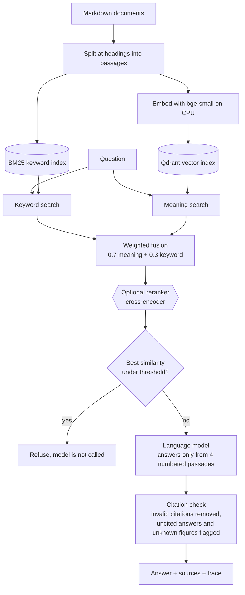

# RAG knowledge assistant with citations

An assistant that answers staff questions from a company's own documents, cites the passage behind
every sentence, and says "I could not find this in the documents" instead of guessing.

It is built for the case every company has: a handbook, procedures and manuals that nobody has
time to read. The demo runs on the operations handbook of a fictional parcel carrier (20
documents). Swap the Markdown files in `data/handbook/` for your own and it answers from those.

What makes it different from a weekend RAG demo is that **every design choice is measured**, on a
public benchmark and on a 100-question set for the handbook, and the numbers decided the design.
One of them removed a component I had planned to ship switched on (see [Results](#results)).

```text
$ python -m rag.cli ask "My overnight parcel showed up two days late. Do I get my money back?"

According to [2], if an Express parcel arrives more than 24 hours after the promised time, the
shipping fee for that parcel is credited to the account. However, this guarantee does not apply
to delays caused by severe weather, customs holds, or during the peak season. [...]

[2] Service levels and transit times > Express guarantee  (data/handbook/service-levels.md)

model llama3.2-cpu, 410+83 tokens, $0.0, 40088.48 ms
```

(Real output, from a 3B model running locally on a 2014 4-core CPU, which is why it took 40
seconds. The question shares almost no words with the passage that answers it.)

## How it works



1. **Split.** Documents are cut at their headings, because a heading is where the author changed
   subject. The title and heading stay attached to each passage.
2. **Two searches.** Keyword search (BM25) is exact on codes and names. Meaning search
   (embeddings in Qdrant) understands rephrasing. Each covers the other's weak spot.
3. **Fusion.** The two result lists are merged by score, 70% meaning and 30% keyword. That
   weight was chosen on training queries of a public benchmark, not on the questions I report.
4. **Relevance gate.** If no passage is similar enough to the question, the assistant refuses
   before the model is called. It costs nothing and does not rely on the model behaving.
5. **Answer.** The model gets four numbered passages and must cite a number after each claim.
6. **Checks.** A citation to a passage that was not provided is removed. An answer with no
   citation, or with a figure that is not in the cited passages, is flagged.

## Results

Every number below was produced by the command named next to it, on a 4-core Intel Xeon E5-1620 v3
(2014), CPU only. The saved output of each run is in `evals/report-*.json`.

### Retrieval on a public benchmark (BEIR SciFact)

5,183 scientific abstracts, 300 test claims labelled by people. `python -m evals.retrieval --dataset scifact --rerankers Xenova/ms-marco-MiniLM-L-6-v2`

| Stage | Hit@1 | Hit@4 | Recall@10 | MRR@10 | nDCG@10 | Median latency |
|---|---|---|---|---|---|---|
| Keyword (BM25) | 0.550 | 0.723 | 0.805 | 0.638 | 0.673 | 0.3 ms |
| Meaning (bge-small embeddings) | 0.603 | 0.757 | 0.845 | 0.685 | 0.720 | 54.3 ms |
| **Hybrid (weighted fusion), the default** | **0.630** | **0.770** | **0.865** | **0.708** | **0.742** | 62.3 ms |
| Hybrid + MiniLM cross-encoder reranker | 0.580 | 0.760 | 0.841 | 0.666 | 0.703 | 1724.7 ms |

Two findings:

- **Hybrid beats both single searches** on every metric.
- **The small reranker made results worse and 28 times slower.** It is the reranker most tutorials
  add by default. It stays in the code as an option (`RERANKER=cross-encoder`) and is off.

### How the fusion weight was chosen

`python -m evals.tune_fusion` scores each setting on the 809 SciFact *training* queries, picks the
best, and only then reports it on the two test sets (nDCG@10):

| Fusion | SciFact train (used to choose) | SciFact test | Handbook |
|---|---|---|---|
| Keyword only | 0.685 | 0.673 | 0.750 |
| Meaning only | 0.752 | 0.720 | 0.957 |
| Rank fusion (RRF) | 0.752 | 0.724 | 0.875 |
| Weighted, meaning 0.5 | 0.767 | 0.741 | 0.902 |
| **Weighted, meaning 0.7 (chosen)** | **0.770** | 0.742 | 0.929 |
| Weighted, meaning 0.9 | 0.760 | 0.729 | 0.957 |

Reciprocal rank fusion, the usual default, added nothing over meaning search alone on the
training queries. Weighted score fusion did.

### Retrieval on the demo handbook

85 passages, 86 answerable questions that I wrote: 38 direct, 39 deliberately rephrased so they share
few words with the answer, 9 that look up a code. `python -m evals.retrieval --dataset handbook --rerankers Xenova/ms-marco-MiniLM-L-6-v2,BAAI/bge-reranker-base`

| Stage | Hit@1 | Hit@4 | MRR@10 | nDCG@10 | Median latency |
|---|---|---|---|---|---|
| Keyword (BM25) | 0.663 | 0.802 | 0.727 | 0.749 | 0.1 ms |
| Meaning (embeddings) | 0.919 | 0.988 | 0.947 | 0.957 | 8.3 ms |
| **Hybrid (weighted fusion), the default** | 0.849 | 0.965 | 0.912 | 0.929 | 8.7 ms |
| Hybrid + MiniLM reranker | 0.872 | 0.965 | 0.910 | 0.922 | 233.9 ms |
| Hybrid + bge-reranker-base | 0.907 | 0.977 | 0.936 | 0.945 | 1521.6 ms |

The right passage is among the four the model receives for 96.5% of questions (83 of 86). On this
set meaning search alone does slightly better than hybrid, because 45% of the questions were
written to avoid the document's words: keyword search finds the right passage first for only 31%
of those, against 87% for meaning search. I kept the weight chosen on the public training queries
instead of tuning it to my own questions. `DENSE_WEIGHT=1.0` switches to meaning search alone.

### Answers

`python -m evals.answers` on the 100 handbook questions (86 answerable, 14 the handbook does not
cover). An answer counts as correct when it is not a refusal, cites a passage that really contains
the answer, and states the expected fact.

| Answer writer | Questions | Correct (answerable) | Cited the right passage | Wrongly refused | Out-of-scope refused | Answers with a warning |
|---|---|---|---|---|---|---|
| Offline stand-in (quotes the top passage) | 86 + 14 | 65 / 86 | 69 / 86 | 6 | 4 / 14 | 0 |
| llama3.2, 3B, local (sample) | 43 + 14 | 33 / 43 | 33 / 43 | 9 | 14 / 14 | 3 |

The offline stand-in is not a model: it quotes sentences from the first passage only, so its score shows that the pipeline works and nothing more. The llama3.2 row is a small open model on a sample of the questions (`--limit 43`); a hosted model such as gpt-4o-mini has not been measured in this build. The small model never answered an out-of-scope question, and its typical error was the opposite: it refused 9 questions whose answer was in the passages it had been given.

### Refusal threshold

`python -m evals.answers --gate-sweep`: the best similarity between a question and any passage.

| Threshold | Answerable questions wrongly refused | Out-of-scope questions stopped before the model |
|---|---|---|
| 0.55 | 0 / 86 | 4 / 14 |
| **0.60 (default)** | 0 / 86 | 4 / 14 |
| 0.65 | 2 / 86 | 7 / 14 |
| 0.70 | 17 / 86 | 8 / 14 |

The gate only stops questions that are clearly off topic ("What is the capital of Australia?").
Questions that are on topic but not covered ("Does Kestrel deliver to Canada?") look like real
questions to any similarity score, so they are left to the model, whose prompt tells it to refuse.

### Tests

`pytest -q`: **67 passed**, offline, no key and no model download.

## Quick start

No API key is needed. The first run downloads the embedding model (about 70 MB).

```bash
git clone https://github.com/BelAnas/rag-knowledge-assistant.git
cd rag-knowledge-assistant
python -m venv .venv && source .venv/bin/activate
pip install -r requirements.txt

python -m rag.cli serve            # then open http://127.0.0.1:8021
```

Or from the terminal:

```bash
python -m rag.cli ask "How long do I have to report a damaged parcel?"
python -m rag.cli search "late parcel refund" --mode hybrid
pytest -q
```

```text
$ python -m rag.cli ask "How long do I have to report a damaged parcel?"

Damage must be reported within 7 calendar days of delivery. [1] The claim form asks for four
photos: the outer box, the shipping label, the inner packaging and the damaged item. [1]

[1] Damage and loss claims > Reporting damage  (data/handbook/damage-and-loss-claims.md)

model mock-extractive, 0+0 tokens, $0.0, 30.25 ms

$ python -m rag.cli ask "Does the mobile app have a dark mode?"

I could not find this in the documents.

(refused: relevance gate)
```

Without a key the answer is written by an offline stand-in that quotes the best-matching
sentences of the top passage. Retrieval, the gate and the citation checks are the real ones.

With Docker:

```bash
docker build -t rag-knowledge-assistant .
docker run -p 8021:8021 rag-knowledge-assistant
```

### Use a real language model

Copy `.env.example` to `.env` and set:

```bash
LLM_PROVIDER=openai
OPENAI_API_KEY=sk-...
OPENAI_MODEL=gpt-4o-mini
```

Any server that speaks the OpenAI format works. For a local model with Ollama:

```bash
LLM_PROVIDER=openai OPENAI_BASE_URL=http://localhost:11434/v1 OPENAI_MODEL=llama3.2 python -m rag.cli serve
```

### Use your own documents

Put Markdown files in a folder and point `DOCS_DIR` at it. The index rebuilds itself when a file
changes. To measure quality on your documents, write questions in the format of
`evals/questions.jsonl` and run the two evaluation commands.

### Reproduce the benchmark

```bash
python -m scripts.download_scifact     # public dataset, about 3 MB download
python -m evals.retrieval --dataset scifact
python -m evals.tune_fusion
```

Embedding the 5,183 abstracts took 19 minutes on the CPU above. It is done once and cached.

## Configuration

| Variable | Default | Meaning |
|---|---|---|
| `LLM_PROVIDER` | `mock` | `mock` (offline) or `openai` (any OpenAI-compatible API) |
| `OPENAI_MODEL`, `OPENAI_BASE_URL`, `OPENAI_API_KEY` | `gpt-4o-mini`, empty, empty | Which model, where, and the key |
| `MAX_OUTPUT_TOKENS` | `300` | Cap on the length, and so the cost, of one answer |
| `DOCS_DIR` | `data/handbook` | Folder of Markdown documents |
| `EMBEDDER`, `EMBEDDING_MODEL` | `fastembed`, `BAAI/bge-small-en-v1.5` | Embedding model (`hash` = offline stand-in for tests) |
| `DENSE_WEIGHT` | `0.7` | Share of the fused score that comes from meaning search |
| `RERANKER`, `RERANKER_MODEL` | `none`, `Xenova/ms-marco-MiniLM-L-6-v2` | `cross-encoder` turns reranking on |
| `MIN_RELEVANCE` | `0.60` | Refuse when the best passage similarity is under this |
| `FINAL_K` | `4` | Passages given to the model |
| `QDRANT_URL` | empty | Empty = embedded on-disk index. A URL = a Qdrant server |

## API

| Endpoint | What it does |
|---|---|
| `POST /ask` `{"question": "..."}` | Answer, citations, the passages used, warnings, timing and cost trace |
| `POST /search` `{"query": "...", "mode": "bm25\|dense\|hybrid\|hybrid_rerank", "k": 5}` | Retrieval only, to inspect each stage |
| `GET /documents`, `GET /documents/{id}` | The indexed documents and their sections |
| `GET /health` | Loaded models and index size |
| `GET /docs` | Interactive API documentation |

## Project structure

```text
rag/
  chunking.py    split Markdown at headings into passages
  bm25.py        keyword search
  embed.py       embedding model on CPU (and the offline stand-in)
  index.py       build, save and reload the Qdrant + BM25 index
  retrieve.py    the two searches, fusion, optional reranking
  rerank.py      cross-encoder reranker (optional)
  llm.py         prompt, OpenAI-compatible provider, offline answer writer
  answer.py      relevance gate, answer, citation and figure checks
  api.py         FastAPI service        cli.py   command line
  static/        the demo page
data/handbook/   20 Markdown documents (the demo knowledge base)
evals/
  questions.jsonl   100 handbook questions with the passage that answers each
  retrieval.py      retrieval metrics per stage
  tune_fusion.py    fusion weight chosen on training queries
  answers.py        answer quality and the refusal threshold sweep
  report-*.json     saved output of the runs quoted above
scripts/download_scifact.py
tests/              offline test suite
```

## Limits

- The demo corpus is small (20 documents, 85 passages) and synthetic. The handbook questions were
  written by the same person who wrote the handbook. The SciFact numbers are the independent ones.
- The refusal threshold was read off the same 100 handbook questions it is reported on, and it is
  specific to the bge-small embedding model.
- The relevance gate stops only clearly off-topic questions (4 of 14). Refusing on-topic questions
  the documents do not cover depends on the language model following its instructions.
- The citation check proves that a cited passage exists and contains the answer's figures. It does
  not prove that the passage supports every word of the sentence.
- The larger reranker (bge-reranker-base) was measured on the handbook only, not on SciFact: on
  this CPU that run would take over an hour.
- English only with the default models. Markdown only: PDF, Word and HTML need a conversion step.
- No user accounts and no per-document permissions: everyone can retrieve every passage.
- One question at a time: there is no conversation memory or follow-up question handling.
- The embedded Qdrant index is for one process. Several API workers need a Qdrant server
  (`QDRANT_URL`), which was not exercised in this build.
- The answer check on the OpenAI API has not been run (no key was available during the build).
  Real-model results come from a local 3B model.

## License

MIT. See [LICENSE](LICENSE).
